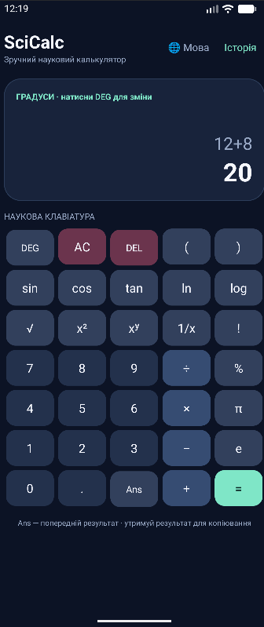

# SciCalc — лабораторна робота №3 з ООП

**Варіант 7:** Android-застосунок «Калькулятор» із підтримкою наукових обчислень та графічним інтерфейсом.

**Технології:** Java 17 (сумісність вихідного коду), Android SDK 36, Gradle 9.6.0, Android Gradle Plugin 9.5.1, JUnit 4, JaCoCo, Android `Logcat`. **Мови інтерфейсу:** українська, англійська, польська.

> Проєкт створено для Android, а не для запуску командою `java Main` або через Maven. **Android Studio / Android SDK потрібні для збірки APK та запуску емулятора.** 

## Інтерфейс застосунку



---

## 1. Мета та вимоги завдання

Створити Android-калькулятор, що виконує звичайні та наукові обчислення й має зрозумілий графічний інтерфейс. Застосунок відповідає таким вимогам:

| Вимога | Реалізація |
|---|---|
| Використати Kotlin/Java | Java: `MainActivity`, `core/*`, `AppLogger` |
| Графічний інтерфейс Android | XML-розмітка, адаптивна кнопкова панель із 35 клавіш |
| Наукові обчислення | Тригонометрія, логарифми, корені, степені, факторіал, відсотки, π, e |
| Logger | Єдиний клас `AppLogger`, журнал `Logcat` з тегом `SciCalc` |
| Підтримка кількох мов (i18n) | Ресурси `values`, `values-uk`, `values-pl`; вибір мови в застосунку |
| Додатково: Unit-тести | JUnit для незалежного від Android ядра калькулятора |

## 2. Функціональні можливості

- **Арифметика:** `+`, `−`, `×`, `÷`, дужки, десяткові дроби.
- **Наукові функції:** `sin`, `cos`, `tan`, `ln`, `log` (за основою 10), `√`, `x²`, `xʸ`, `1/x`, `!`, `%`.
- **Константи:** `π`, `e`, а також `Ans` — останній обчислений результат.
- **Кутові одиниці:** `DEG` (градуси) та `RAD` (радіани), перемикання однією кнопкою.
- **Коректний порядок дій:** степінь, факторіал, пріоритет множення й додавання, вкладені дужки, унарний мінус.
- **Автоматичне попереднє значення:** результат оновлюється, коли введений вираз повний і правильний.
- **Історія:** до 12 останніх обчислень, повторне використання результату, очищення історії.
- **Збереження стану:** остання відповідь, історія, кутовий режим та обрана мова зберігаються між запусками; введений вираз зберігається при повороті екрана.
- **Копіювання:** довге натискання на результат копіює його до буфера обміну.
- **Обробка помилок:** ділення на нуль, некоректні вирази, порушення області визначення, переповнення, надто складні вирази. Повідомлення локалізовані.

**Приклади:** `2+3×4 = 14`; `sin(30) = 0.5` у DEG; `2^3^2 = 512`; `√(81)+5! = 129`.

## 3. Архітектура

```text
MainActivity (Android UI та i18n)
    │ натискання кнопок, відображення, історія
    ▼
CalculatorSession (стан, Ans, історія, маршрутизація дій)
    ├── ExpressionEvaluator (розбір і обчислення математичних виразів)
    ├── ResultFormatter (округлення та представлення чисел)
    ├── AngleMode / CalculationException (типізовані стани)
    └── HistoryEntry (незмінний запис історії)

AppLogger → Android Logcat
Android strings.xml → локалізація UI, повідомлень та помилок
```

### Як працює парсер математичних виразів

`ExpressionEvaluator` — **рекурсивний спуск** (recursive descent): він поетапно розбирає рядок відповідно до пріоритету операцій. На відміну від `eval` зі сторонніх бібліотек, тут власна реалізація на Java. Підтримується, зокрема, `-2^2 = -4` та `2^3^2 = 512`, а також множення без знака, як-от `2π` або `2(3+4)`.

## 4. Структура проєкту

```text
SciCalc_OOP_Lab3/
├── .editorconfig
├── .gitignore
├── README.md
├── settings.gradle
├── build.gradle
├── gradle.properties
├── gradlew                 # Linux / macOS
├── gradlew.bat             # Windows
├── gradle/wrapper/
│   ├── gradle-wrapper.properties
│   └── gradle-wrapper.jar   # завантажиться при першому запуску gradlew
└── app/
    ├── build.gradle
    └── src/
        ├── main/
        │   ├── AndroidManifest.xml
        │   ├── java/ua/edu/oop/scicalc/
        │   │   ├── MainActivity.java
        │   │   ├── AppLogger.java
        │   │   └── core/
        │   │       ├── AngleMode.java
        │   │       ├── CalculationException.java
        │   │       ├── ExpressionEvaluator.java
        │   │       ├── ResultFormatter.java
        │   │       ├── CalculatorSession.java
        │   │       └── HistoryEntry.java
        │   └── res/
        │       ├── layout/activity_main.xml
        │       ├── drawable/
        │       ├── values/{strings.xml,colors.xml,styles.xml}
        │       ├── values-uk/strings.xml
        │       ├── values-pl/strings.xml
        │       └── xml/locales_config.xml
        └── test/java/ua/edu/oop/scicalc/core/
            ├── ExpressionEvaluatorTest.java
            ├── CalculatorSessionTest.java
            └── ResultFormatterTest.java
```

## 5. Збірка APK і запуск

Відкрийте **Terminal** у корені проєкту в Android Studio або VS Code (Windows / CMD):

```cmd
gradlew.bat --version
gradlew.bat clean assembleDebug
```

Після успішної збірки файл APK з'явиться за шляхом:

```text
app\build\outputs\apk\debug\app-debug.apk
```

Запуск у Android Studio:

1. **Tools → Device Manager → Create device**, наприклад Pixel із Android 16 / API 36.
2. Запустіть емулятор (кнопка ▶).
3. У верхній панелі виберіть **app**, натисніть зелений ▶ **Run**.
4. На емуляторі з'явиться калькулятор **SciCalc**.

Замість емулятора можна під'єднати справжній Android-смартфон із увімкненим **USB debugging**. Додаткових дозволів на інтернет, камеру або місцеположення застосунок не потребує.

## 6. Unit-тести та покриття JaCoCo

Unit-тести перевіряють математичні операції, порядок дій, градуси/радіани, `Ans`, обробку помилок, форматування, стан і історію.

```cmd
gradlew.bat :app:testDebugUnitTest
```

HTML-звіт JUnit:

```text
app\build\reports\tests\testDebugUnitTest\index.html
```

HTML-звіт JaCoCo (Android Gradle Plugin):

```cmd
gradlew.bat :app:createDebugUnitTestCoverageReport
```

```text
app\build\reports\coverage\test\debug\index.html
```

## 7. Ручні сценарії перевірки застосунку

| Дія | Очікуваний результат |
|---|---|
| `2 + 3 × 4 =` | `14` |
| `( 2 + 3 ) × 4 =` | `20` |
| `sin ( 30 ) =` у DEG | `0.5` |
| `sin ( π ÷ 2 ) =` у RAD | `1` |
| `√ ( 81 ) + 5 ! =` | `129` |
| `log ( 100 ) =` | `2` |
| `2 ÷ 0 =` | Локалізована помилка ділення на нуль, без падіння застосунку |
| `AC` | Очистити введення, не стерти `Ans` та історію |
| `DEL` | Видалити останній символ або вставлену функцію |
| `History` / `Історія` | Показати останні обчислення |
| `🌐 Мова` | Вибір української, англійської, польської чи мови системи |
| Повернути екран або перезапустити | Відновлення режиму, відповіді та історії |

## 8. Міжнародна локалізація (i18n)

Тексти **не захардкоджені** в Java-коді, а взяті з Android-ресурсів:

- `res/values/strings.xml` — англійська за замовчуванням;
- `res/values-uk/strings.xml` — українська;
- `res/values-pl/strings.xml` — польська;
- `res/xml/locales_config.xml` — перелік підтримуваних мов для налаштувань Android 13+.

У застосунку кнопка **🌐 Мова / Language / Język** відкриває вибір мови; налаштування зберігається в `SharedPreferences`. Режим «Як у системі» автоматично використовує мову смартфона. Математичні символи залишаються однаковими для всіх мов.

## 9. Logger / Logcat

`AppLogger` централізує записи через `android.util.Log` з тегом **`SciCalc`**. Логуються запуск застосунку, успішні обчислення, помилки обчислень, зміна мови, очищення історії; приватний текст виразів навмисно не записується.

## 10. Висновок

Розроблено Android-застосунок «SciCalc» для звичайних і наукових обчислень. Реалізовано розділення математичного ядра та графічного інтерфейсу, обробку помилок, історію, три мови, налаштоване логування й автоматизовані Unit-тести. 